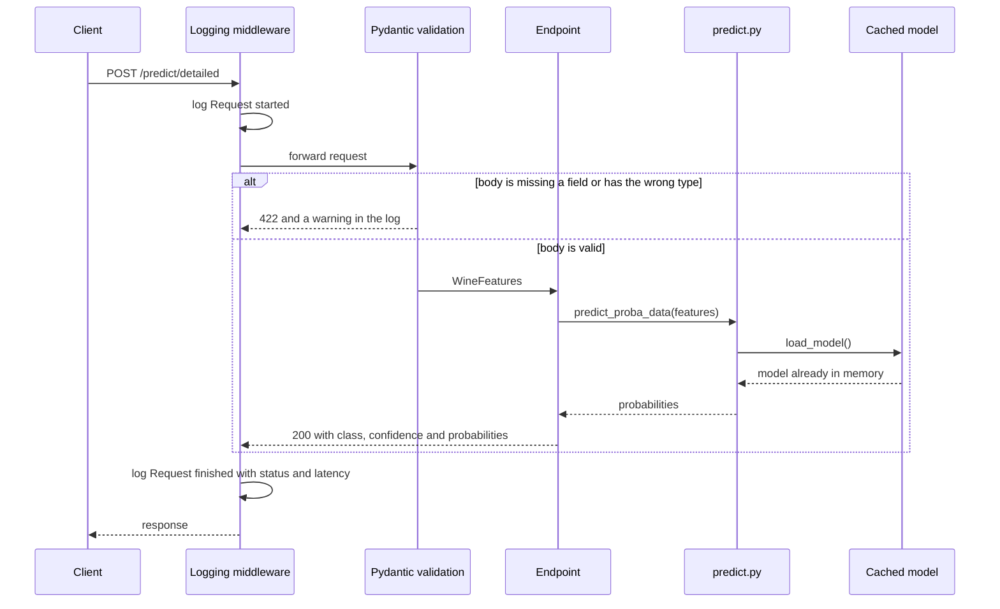
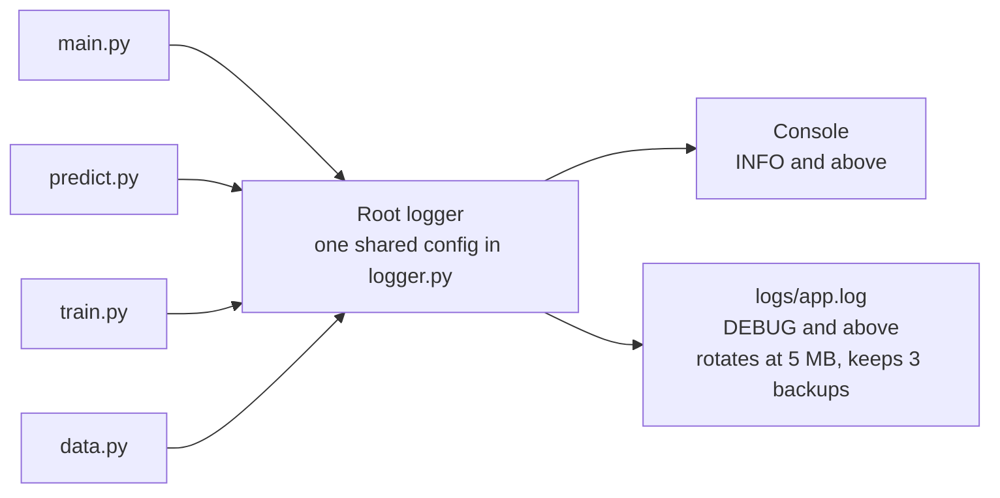

# IE7374 Lab Assignment 2: Wine Classifier API with FastAPI and Logging

A REST API that serves a gradient boosting model trained on the Wine dataset. It
answers with a predicted cultivar, and on request with the model's confidence and
the full probability for every class. Every request, prediction and error is
logged to the console and to a rotating log file, and the model is loaded once
when the server starts rather than on every call.

## At a Glance

| What to check | Answer |
|---|---|
| Based on | API_Labs/FastAPI_Labs from the course repository |
| Lab activities covered | Lab 1 FastAPI and Lab 2 Logging, combined in one project |
| Core concept changed | The API itself: a new endpoint, a startup lifecycle that caches the model, structured error responses, and request logging. See [Changes Made to the Lab](#changes-made-to-the-lab) |
| Advanced extension | Confidence scores and a full probability breakdown through /predict/detailed. See [Advanced Extension](#advanced-extension-confidence-scores-through-predictdetailed) |
| Proof that it works | 7 automated API tests plus sample calls and log output. See [What a Successful Run Looks Like](#what-a-successful-run-looks-like) |
| Run it yourself | Train, start the server, call it. See [Running the Code](#running-the-code) |

## Endpoints

| Method | Path | Returns | Error responses |
|---|---|---|---|
| GET | / | Health status, model name and the list of endpoints | None |
| POST | /predict | Predicted class index and cultivar name | 422 invalid body, 503 no trained model |
| POST | /predict/detailed | Class, name, confidence and the probability for each cultivar | 422 invalid body, 503 no trained model |

Both prediction endpoints take the same body: the 13 chemical measurements of a
wine, such as alcohol, flavanoids, color_intensity and proline.

## How a Request Flows



The model reaches memory before the first request arrives. When the server
starts, a lifespan hook calls load_model() once and the result is cached, so the
cached model box above is always a memory lookup. If no model has been trained
yet, the server still starts, logs a warning, and the prediction endpoints answer
503 with a clear message until train.py has been run.

## How Logging Is Wired



Every module asks logger.py for its logger, so all records share one format that
names the module they came from. The console shows what an operator needs to
follow the server live. The file keeps everything, including debug detail such
as input shapes and raw probability arrays, for investigating a problem later.

## Changes Made to the Lab

| Area | Original FastAPI lab | This version |
|---|---|---|
| Dataset | Iris, 4 features | Wine, 13 chemical features, 3 cultivars |
| Model | DecisionTreeClassifier, depth 3 | GradientBoostingClassifier, 100 trees |
| Endpoints | GET / and POST /predict | Adds POST /predict/detailed with confidence scores |
| Response | A bare integer | Class index plus cultivar name |
| Model loading | Read from disk on every request | Loaded once at startup and kept in memory, first prediction 630.9 ms down to 4.3 ms |
| Missing model | Generic 500 error | 503 with a message that says to run train.py |
| Invalid input | Default FastAPI 422, not logged | 422 and a warning in the log naming the bad field |
| Logging | None | Central config, request middleware, console plus rotating file |
| Tests | None | 7 API tests with FastAPI's TestClient |

**Data and model**

The Iris dataset was replaced with the Wine dataset from scikit-learn: 178 wines,
13 measurements each, from three cultivars grown in the same region of Italy. The
70/30 split and random_state=12 from the original were kept so the comparison
stays fair. The decision tree was replaced with a GradientBoostingClassifier with
100 trees and a learning rate of 0.1, which reaches 94.4 percent accuracy on the
held out wines.

**Loading the model once**

The original predict.py read the model file from disk on every call. That is
fine for a demo, but under real traffic it repeats the same slow file read for
every request. The loader is now cached, and a lifespan hook fills the cache when
the server starts. A test sends five requests and checks that the file was read
exactly once. Because a missing file raises an error that is not cached, the API
picks up the model as soon as it is trained. To load a retrained model over an
existing one, restart the server.

**Error handling**

The original wrapped everything in a single except that returned 500 with the
raw exception text. This version separates the cases a caller can act on. A body
that fails validation returns 422 and is logged as a warning. A missing model
returns 503, which tells the caller the service is not ready rather than broken.
Anything unexpected returns 500 with a generic message, while the full traceback
goes to the log file instead of to the caller.

**Logging**

A central logger.py configures two handlers on the root logger, and every module
uses it. An HTTP middleware logs each request when it starts and again when it
finishes, with the status code and the time it took in milliseconds.

## Advanced Extension: Confidence Scores through /predict/detailed

**Why this was chosen**

A model that only returns a class label hides how sure it is. A prediction made
with 40 percent confidence and one made with 99 percent look identical when the
API answers with a single integer, yet they call for very different actions. In
high stakes settings, such as the drug supply chain work in my course project, an
uncertain prediction should go to a person for review instead of triggering an
automatic decision.

**How it works**

The endpoint calls predict_proba() on the model, which returns one probability
per cultivar. The cultivar with the highest probability becomes the prediction,
and that probability is returned as the confidence. The full breakdown is keyed
by cultivar name rather than by index, so callers never need to know the internal
class mapping. A test checks that the probabilities add up to one, that the
confidence equals the largest probability, and that the named class is the one
with that probability.

**What it produces**

| Field | Example | Meaning |
|---|---|---|
| predicted_class | 0 | Index of the most likely cultivar |
| class_name | Barolo | Name of that cultivar |
| confidence | 1.0 | Probability of the predicted cultivar |
| probabilities | Barolo 1.0, Grignolino 0.0, Barbera 0.0 | Probability for every cultivar |

A caller can set its own threshold on confidence and route anything below it to
a human, with no extra work on the server side.

## Prerequisites

Python 3.14, which is the version this project was tested with. Download from
https://www.python.org/downloads and verify with: python3 --version

Git. Download from https://git-scm.com and verify with: git --version

The Python packages are pinned in requirements.txt: fastapi[all] 0.111.1,
scikit-learn 1.5.1 and joblib 1.4.2, plus pytest for the tests.

## Environment Setup

Clone the repository.

```
git clone https://github.com/lequo-neu/IE7374-FastAPI-Assignment2.git
cd IE7374-FastAPI-Assignment2
```

Create and activate a virtual environment, then install the dependencies.

```
python3 -m venv venv
source venv/bin/activate
pip install -r requirements.txt
```

## Running the Code

Run the API tests from the project root. They train a model into a temporary
folder, so they work before train.py has ever been run.

```
pytest -v
```

Train the model. Run this from inside src/ so the model and log folders resolve
correctly.

```
cd src
python train.py
```

Start the server, still from inside src/.

```
uvicorn main:app --reload
```

Open http://127.0.0.1:8000/docs in a browser to try every endpoint from the
interactive page, or call the API from a second terminal.

```
curl http://127.0.0.1:8000/
curl -X POST http://127.0.0.1:8000/predict/detailed -H "Content-Type: application/json" -d '{"alcohol": 13.2, "malic_acid": 1.78, "ash": 2.14, "alcalinity_of_ash": 11.2, "magnesium": 100.0, "total_phenols": 2.65, "flavanoids": 2.76, "nonflavanoid_phenols": 0.26, "proanthocyanins": 1.28, "color_intensity": 4.38, "hue": 1.05, "od280_od315_of_diluted_wines": 3.4, "proline": 1050.0}'
curl -X POST http://127.0.0.1:8000/predict -H "Content-Type: application/json" -d '{"alcohol": 13.2}'
```

## What a Successful Run Looks Like

| Check | Result |
|---|---|
| API tests | 7 passed |
| Test accuracy after training | 0.9444 on 54 held out wines |
| Model loading | Read from disk once, at startup |
| First /predict/detailed call | 4.3 ms, down from 630.9 ms before the model was cached |
| Invalid body | 422 listing every missing field, logged as a warning |

The latency numbers were measured on a local laptop. They show the difference
caching makes rather than a benchmark.

**Tests**

```
test/test_api.py::test_health_lists_the_endpoints PASSED
test/test_api.py::test_predict_returns_class_and_name PASSED
test/test_api.py::test_detailed_probabilities_are_consistent PASSED
test/test_api.py::test_missing_field_returns_422_and_is_logged PASSED
test/test_api.py::test_missing_model_returns_503 PASSED
test/test_api.py::test_middleware_logs_status_and_latency PASSED
test/test_api.py::test_model_is_loaded_once_for_many_requests PASSED

7 passed in 0.66s
```

**Training**

```
[__main__] INFO: === Training pipeline started ===
[data] INFO: Loading Wine dataset (178 samples, 13 features, 3 classes).
[data] INFO: Train/test split complete. Train: 124 samples | Test: 54 samples.
[__main__] INFO: Training GradientBoostingClassifier (n_estimators=100, learning_rate=0.1, random_state=12).
[__main__] INFO: Model training complete.
[__main__] INFO: Test accuracy: 0.9444
[__main__] INFO: Model saved to ../model/wine_model.pkl
[__main__] INFO: === Training pipeline complete ===
```

**Server startup**

The model is in memory before the server reports that it is ready.

```
INFO:     Uvicorn running on http://127.0.0.1:8000 (Press CTRL+C to quit)
INFO:     Waiting for application startup.
[predict] INFO: Model loaded from ../model/wine_model.pkl
[main] INFO: Model loaded and cached at startup.
INFO:     Application startup complete.
```

**Responses**

The health check:

```json
{"status": "healthy", "model": "GradientBoostingClassifier", "dataset": "Wine (sklearn)", "endpoints": ["/predict", "/predict/detailed"]}
```

A detailed prediction for the sample Barolo:

```json
{"predicted_class": 0, "class_name": "Barolo", "confidence": 1.0, "probabilities": {"Barolo": 1.0, "Grignolino": 0.0, "Barbera": 0.0}}
```

A body with only one field, which returns 422 and names each missing field.
The first two of the twelve entries are shown here.

```json
{"detail": [{"type": "missing", "loc": ["body", "malic_acid"], "msg": "Field required", "input": {"alcohol": 13.2}}, {"type": "missing", "loc": ["body", "ash"], "msg": "Field required", "input": {"alcohol": 13.2}}]}
```

**Log file**

The same three calls as recorded in logs/app.log. Each request is bracketed by a
started and a finished line, and the file also keeps the debug detail that the
console leaves out. The raw probabilities show why the confidence rounds to 1.0:
the model gives Barolo 0.999999.

```
[main] INFO: Request started: GET /
[main] DEBUG: Health check endpoint called.
[main] INFO: Request finished: GET /, status 200, 0.7 ms
[main] INFO: Request started: POST /predict/detailed
[main] INFO: POST /predict/detailed called.
[predict] DEBUG: predict_proba_data called. Input shape: (1, 13)
[predict] INFO: Probability scores: [[0.999998688555131, 7.768319025887161e-07, 5.346129664186703e-07]]
[main] INFO: Detailed prediction: 0 (Barolo) confidence=1.0000
[main] INFO: Request finished: POST /predict/detailed, status 200, 4.3 ms
[main] INFO: Request started: POST /predict
[main] WARNING: Validation error on /predict: [{'type': 'missing', 'loc': ('body', 'malic_acid'), ...}]
[main] INFO: Request finished: POST /predict, status 422, 0.9 ms
```

Timestamps were removed from these excerpts to keep the lines short. Every line
in the real file starts with the date and time.

## Project Structure

```
IE7374-FastAPI-Assignment2/
    logs/
        app.log                 (created on first run)
    model/
        wine_model.pkl          (created by train.py)
    src/
        __init__.py
        logger.py               (central logging configuration)
        data.py                 (Wine dataset and split)
        train.py                (GradientBoostingClassifier training)
        predict.py              (cached model loading and prediction)
        main.py                 (FastAPI app, lifespan, middleware, endpoints)
    test/
        conftest.py             (trains a model into a temporary folder)
        test_api.py             (7 API tests)
    pytest.ini
    requirements.txt
    .gitignore
    README.md
```
